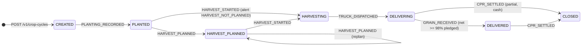
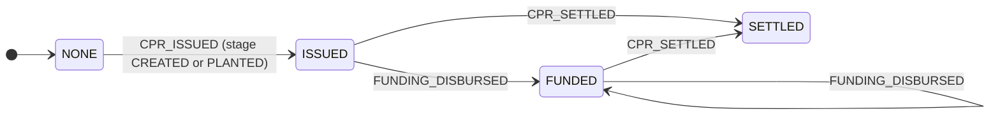

# @agro-cpr/spec: the interface contract (Prompt 0)

This package is the single contract between the three layers. Contracts (A), backend (B) and front-end (C) all build against it. Change it only with the whole team's agreement.

| File | What it is | Used by |
|---|---|---|
| `src/events.ts` | Zod schemas for all 21 canonical events, roles, units, on-chain codes, emitter matrix | B, C, import |
| `src/keys.ts` | On-chain key derivation (HMAC), event-id encoding, canonical JSON and `recordHash` (server only) | A, B |
| `contracts/IAgroLedger.sol` | Smart contract interface | A, B |
| `openapi/openapi.yaml` | REST API skeleton (OpenAPI 3.1) | B, C |
| `generated/*.schema.json` | JSON Schema generated from `events.ts` (`npm run gen`), referenced by the OpenAPI file | C (mocks), import |

## Locked platform choices

| Area | Choice | Alternatives considered |
|---|---|---|
| Chain | Base Sepolia (testnet) | Polygon Amoy, Hyperledger Besu |
| Language | TypeScript end-to-end (Node 24 LTS) | Python (FastAPI), Go |
| API | REST + OpenAPI 3.1, schemas from Zod | tRPC, GraphQL |
| Data, auth, files | Supabase, São Paulo region | Neon + Clerk + R2, AWS |

Tooling for each layer (Foundry vs Hardhat, hosting, UI kit) is decided before that layer's block.

## Decisions to review (15 minutes)

1. **Postgres is the source of truth; the chain is a tamper-evident anchor.** Business rules, authorization and the state machine run in the backend only.
2. **Events attach to a subject, not an "instrument".** The subject is a `PLOT` (`PLOT_REGISTERED`, `SOIL_ANALYSIS_ATTACHED`) or a `CROP_CYCLE` (everything else). A crop cycle is plot + crop + season. This replaces `instrumentId` from the shared context, because plot events happen before any CPR exists.
3. **One CPR per crop cycle, unique per (plot, season), enforced on-chain.** The producer is not part of the key. Otherwise the same land could be pledged twice, once by the owner and once by a tenant. Limit: the same land registered as two different plots is not caught until a polygon-overlap check (PostGIS) is added after the MVP.
4. **One plot per CPR in the pilot.**
5. **Quantities are integers in base units:** `KG`, `M2`, `ML`, `BRL_CENTS`. Sacas are display only (kg / 60). No floats on-chain or in money.
6. **Events record facts, not judgments.** Risk flags, window violations and alerts are derived, never stored in events. The one exception is the warehouse ticket's `discountKg` and `netKg`: those are the warehouse's own numbers. The backend recomputes them from the discount table and raises `QUALITY_TICKET_MISMATCH` instead of rejecting.
7. **The client generates the event `id` (UUIDv7), which is also the idempotency key.** Retries after a bad connection are safe. The server sets `recordedAt` and `recordedBy`.
8. **One write endpoint, `POST /v1/events`, for all canonical events.** Farms, crop cycles, CPR requests, config, imports and files have their own endpoints.
9. **A CPR request is a workflow record, not an event.** When the financier approves it, the backend emits `CPR_ISSUED`.
10. **ADMIN can emit any event on behalf of an org**, for back-office entry of manual data. `recordedBy` keeps who actually typed it.
11. **Corrections.** `EVENT_CORRECTED` comes from the original org or ADMIN; `EVENT_VOIDED` from ADMIN only. Every change is validated by replaying the subject's events with the change applied. A change that breaks the sequence is rejected (`CORRECTION_BREAKS_STREAM`); void the later events first.
12. **"Overdue" is an alert, not a state.**
13. **Trucks must be dispatched to the CPR's designated warehouse** (`WRONG_WAREHOUSE`). A diversion then shows up as a delivery shortfall alert.
14. **One contract, `AgroLedger`:** a soulbound ERC-721 per CPR plus an append-only event log with a hash chain per subject. Tokens go to a platform custody address; on-chain ownership has no legal meaning in the pilot (verify with counsel before any real use).
15. **On-chain keys** are `HMAC-SHA256(LEDGER_KEY_SECRET, "<domain>:<uuid>")` for producer, plot, warehouse and season. `cycleKey = keccak256(abi.encode(plotKey, seasonKey))`, computed by the contract; `tokenId = uint256(cycleKey)`. The on-chain event id is the UUID's 16 bytes, left-aligned. **The secret must not rotate during the pilot.**
16. **`recordHash` = SHA-256 of the RFC 8785 canonical JSON of the stored event** (event plus `recordedAt` and `recordedBy`). Only keys, codes, quantities, timestamps and hashes go on-chain; payloads stay in Postgres.
17. **Timestamps are UTC ISO-8601 with an offset.** Dates such as planting, due date and windows are local dates in America/Sao_Paulo.
18. **Default delivery tolerance: 2%** (a CPR is `DELIVERED` at ≥ 98% of pledged net kg). Configurable.
19. **Proposed repo layout:** pnpm monorepo with `packages/spec`, `contracts/`, `apps/api`, `apps/web`. To be confirmed in the Block 1 and 2 discussions.

## Event catalog

| Code | Event | Subject | Quantity | Evidence | Emitted by |
|---|---|---|---|---|---|
| 1 | PLOT_REGISTERED | PLOT | area M2 | optional | PRODUCER, ADMIN |
| 2 | SOIL_ANALYSIS_ATTACHED | PLOT | none | **required** | PRODUCER, ADMIN |
| 3 | CPR_ISSUED | CROP_CYCLE | issued KG | optional | FINANCIER, ADMIN |
| 4 | FUNDING_DISBURSED | CROP_CYCLE | BRL_CENTS | optional | FINANCIER, ADMIN |
| 5 | PLANTING_RECORDED | CROP_CYCLE | planted M2 | optional | PRODUCER, ADMIN |
| 6 | INPUT_APPLICATION_RECORDED | CROP_CYCLE | KG or ML | **required** | PRODUCER, ADMIN |
| 7 | HARVEST_PLANNED | CROP_CYCLE | expected KG | optional | PRODUCER, ADMIN |
| 8 | HARVEST_STARTED | CROP_CYCLE | none | optional | PRODUCER, ADMIN |
| 9 | TRUCK_DISPATCHED | CROP_CYCLE | estimated KG | optional | PRODUCER, ADMIN |
| 10 | TRUCK_ARRIVED | CROP_CYCLE | none | optional | WAREHOUSE, ADMIN |
| 11 | GRAIN_RECEIVED | CROP_CYCLE | net KG | optional | WAREHOUSE, ADMIN |
| 12 | CDA_ISSUED | CROP_CYCLE | KG | optional | WAREHOUSE, ADMIN |
| 13 | GRAIN_RELEASED | CROP_CYCLE | KG | optional | WAREHOUSE, ADMIN |
| 14 | SALE_RECORDED | CROP_CYCLE | KG | optional | BUYER, ADMIN |
| 15 | INFO_REQUESTED | CROP_CYCLE | none | optional | FINANCIER, ADMIN |
| 16 | CPR_SETTLED | CROP_CYCLE | delivered KG | optional | FINANCIER, ADMIN |
| 17 | EVENT_CORRECTED | either | none | optional | original org, ADMIN |
| 18 | EVENT_VOIDED | either | none | optional | ADMIN |
| 19 | POLICY_ISSUED | CROP_CYCLE | insured BRL_CENTS | optional | INSURER, ADMIN |
| 20 | CLAIM_FILED | CROP_CYCLE | estimated loss KG | optional | PRODUCER, ADMIN |
| 21 | CLAIM_SETTLED | CROP_CYCLE | indemnity BRL_CENTS (0 if denied) | optional | INSURER, ADMIN |

Codes are permanent: never renumber, only append.

## State machine (crop cycle)

A crop cycle has two independent tracks: the **field and logistics stage**, and the **CPR status**. A CPR is often issued before planting to finance inputs, so the two tracks must not be merged.

| Event | Allowed when | Effect |
|---|---|---|
| CPR_ISSUED | stage CREATED or PLANTED; CPR NONE; issued ≤ eligible | CPR → ISSUED |
| FUNDING_DISBURSED | CPR ISSUED or FUNDED | CPR → FUNDED |
| PLANTING_RECORDED | stage CREATED; once per cycle (fix with a correction) | → PLANTED |
| INPUT_APPLICATION_RECORDED | stage CREATED to HARVESTING (pre-planting burndown allowed) | none |
| HARVEST_PLANNED | stage PLANTED or HARVEST_PLANNED; repeatable, latest wins | → HARVEST_PLANNED |
| HARVEST_STARTED | stage PLANTED or HARVEST_PLANNED | → HARVESTING |
| TRUCK_DISPATCHED | stage HARVESTING or DELIVERING; CPR issued; designated warehouse | → DELIVERING |
| TRUCK_ARRIVED | its `deliveryId` dispatched and not yet arrived | none |
| GRAIN_RECEIVED | its `deliveryId` arrived and not yet received | → DELIVERED once net ≥ 98% pledged |
| CDA_ISSUED | ≥ 1 receipt; Σ CDA kg ≤ Σ net received | none |
| GRAIN_RELEASED | Σ released ≤ Σ CDA kg | none |
| SALE_RECORDED | ≥ 1 receipt; Σ sold ≤ Σ net received | none |
| INFO_REQUESTED | any time | opens `INFO_REQUEST_OPEN` alert |
| CPR_SETTLED | CPR ISSUED or FUNDED; FULLY_DELIVERED needs DELIVERED; partial cash settlement from DELIVERING | CPR → SETTLED, stage → CLOSED |
| POLICY_ISSUED | the insurer is linked to the cycle; policy number unique per cycle; ends after it starts | adds a policy |
| CLAIM_FILED | an active policy with that number; once per `claimId` | opens `CLAIM_OPEN` alert |
| CLAIM_SETTLED | its claim filed and not yet settled; by the policy's insurer; DENIED pays 0 | closes the claim |
| EVENT_CORRECTED / VOIDED | any time; must survive replay | recompute everything |

After CLOSED, only `INFO_REQUESTED`, the insurance events, `EVENT_CORRECTED` and `EVENT_VOIDED` are accepted (a claim can outlive the CPR).

Plot subject: `PLOT_REGISTERED` once, then `SOIL_ANALYSIS_ATTACHED` any number of times.

## Who can read what

Insurance (added after the first release): the producer links an insurer to a crop cycle, the same way a CPR request links a financier. Policies never change the risk grade; they are shown next to it.

| Role | Sees |
|---|---|
| PRODUCER | Own farms, plots, cycles, CPRs, alerts |
| WAREHOUSE | Cycles whose CPR designates it: delivery, quality, CDA events, plus CPR volume and dates |
| BUYER | Cycles where it has a release or sale: volumes, quality and those events |
| FINANCIER | Cycles with a CPR request or CPR addressed to it: everything, including plot and soil data |
| INSURER | Cycles whose producer linked it (`POST /v1/crop-cycles/{id}/insurers`): everything, like a financier |
| ADMIN | Everything |

## Notes for Prompt 1 (contracts)

- `EventRecorded` has 11 fields; compile with `via_ir = true` to avoid "stack too deep".
- `recordEvent` must reject codes 3 and 16 (`ReservedEventType`); those go through `issueCpr` and `settleCpr`.
- `issueCpr` checks that `issuedEvent.subjectKey == cycleKeyFor(plotKey, seasonKey)` and that `issuedEvent.eventType == 3`.

## Open questions for the product owner

1. Uniqueness keyed on land (plot + season) rather than producer: agreed? (decision 3)
2. One plot per CPR for the pilot, though real CPRs often cover several talhões?
3. Block CPR issuance once harvest has started?
4. A truck sent to a non-designated warehouse: reject at dispatch (current), or accept with a HIGH alert?
5. Who records a sale: buyer only (current), or the producer as well?
6. Should a producer's answer to `INFO_REQUESTED` be its own event (`INFO_PROVIDED`, code 19)?
7. Is a 2% delivery tolerance right?
8. Is "serialista" in the original brief the securitizadora?
